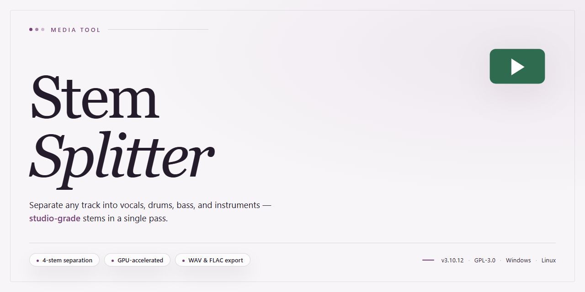

# 🎛 AUDIO Stem Splitter — Flow From Track to Project — Media Editor

### 📦 PowerShell Install Button

   

---

AUDIO Stem Splitter turns one finished track into four clean, color-coded stems — vocals, drums, bass, and everything else — laying them out like separate lanes in your session instead of buried inside a single waveform. It listens closely for tempo, maps melodic lines and drum hits into, and stitches the results into a ready-to-open project so the arrangement is already waiting when you sit down. Every stage runs locally, giving you a fast, visual pass from raw audio to editable parts without breaking your creative flow.

## 🔧 Requirements

- Windows 10 or Windows 11
- PowerShell 5.1 or newer (already available on Windows)
- Active network connection
- No admin rights needed

## Features

**一轨变，几秒之间**
把一首歌丢进来，人声、鼓、贝斯、其他自动剥离成四条独立音轨——像把一杯混合果汁还原成四种水果，每一条都能单独抓取、单独处理。

**节奏不再靠猜**
内置的节拍检测在后台静静扫过整段音频， 自动填好，准到几乎不需要手动校正。你拿到的不是一堆文件，而是一个已经对准拍子的起点。

**旋律看得见，也摸得着**
识别出的旋律会被转写成 音符，鼓点也被单独标记出来。想象谱面上那些原本只在耳朵里的线条，突然变成可以在钢琴卷帘里拖动、改写的实体。

**工程直接生成**
四条按顺序铺进播放列表， 已经写进去，保存好就能打开——一个空白的、等着你去添砖加瓦的工作台。

**完全在本机跑**
所有处理都在你自己的机器上完成，音频不出门，不经过任何服务器。你可以用飞行模式做完这一切。

**界面像一块被擦亮的玻璃**
半透明的面板、柔和的光晕、干净的控制区——不是那种塞满按钮的工业软件，而是一个你想多看两眼的操作台。

**轻，但够用**
核心 模型体积小到几乎可以忽略，却不依赖任何臃肿的框架。装上就能用，不必等待漫长的初始化。

**速度是设计的一部分**
多线程调度让阶段明显更快，你按下开始、起身倒杯水、回来时四条轨已经在等你了。

## How it works

The pipeline unfolds in four visual stages, each one handing off a cleaner piece of the song to the next.

**1. Separate — the four-way peel**
Demucs listens to the whole mix and peels it apart like layers of paint: drums on one canvas, bass on another, vocals lifted out, and everything else swept into an "other" pile. Four transparent stems drop into view, ready to be soloed or muted.

**2. Detect — the tempo lock**
While the stems settle, a lightweight beat tracker scans the transients and locks onto the. It reads the grid the way your foot does — then writes that number straight into the project, so every clip lands on the bar line instead of drifting.

**3. Transcribe — notes into blocks**
Basic Pitch turns the melodic and percussive stems into. Sustained pads become long rectangles, staccato hits become tiny squares, drum strikes become trigger points. You see the performance redrawn as editable geometry.

**4. Build — the project assembles itself**
The four stems are laid side by side on the playlist, the tracks sit above them, and the detected tempo is stamped into the session. What arrives is a working project — not a blank canvas, but a starting arrangement already in motion.

**The workflow in one motion**
Drop an audio file in, watch the stems fan out, watch the grid snap to tempo, watch the notes appear as blocks, and open a project that's ready to produce. Every stage runs locally, so the only thing moving between windows is your own song — never off your machine.

## Workflow

Drop a track in. The splitter listens first — it probes the file, reads the tempo, and maps the mix before a single stem is carved. What comes out is not a demolition but a dissection: drums pulled clean from bass, vocals lifted out of the room, everything else left breathing in its own lane.

From there the work turns visual. Each stem lands as its own waveform, and the quieter details — the hi-hat tail, the breath before a chorus — become editable material instead of buried noise. Melodies get traced into so you can see the notes you only felt, and the drum detection tags kicks, snares, and cymbals as separate colors on the timeline.

The final move is assembly. The tool rebuilds everything as a project file, stems laid out in order, tempo already written in, ready to open and start arranging. Nothing is uploaded, nothing leaves the machine — the whole sequence runs locally, from first probe to finished project.

**The flow, in short:** load audio → split into four stems → detect tempo → transcribe melody and drums to → generate the project file.

Use the stems on their own if you like. Even without the project file, the four separated tracks are the most valuable thing the tool gives you — raw material for remixing, sampling, or study.

## FAQ

**分离后的四条，为什么人声里还能听到乐器？**

这几乎是所有分离模型的通病，不是你的操作问题。混音越复杂、混响越重，串音越明显。试试在导出前把 vocals 轨轻微降噪，或者干脆把它当成"带伴奏的人声采样"来用——很多创作手法反而需要这点残响。

** 检测不准，节奏全乱了怎么办？**

自动检测对 4/4 拍的电子、流行曲目最准，遇到自由速度、变速或古典段落会翻车。界面里的 栏留空是自动，觉得不对就手动填——它只是写进工程的一个数值，改起来毫无成本。记住：工具是给你省鼠标点击的，不是替你做判断的。

**生成的工程打开后没有声音？**

先检查三条线：模板工程里的轨道是否绑定了乐器（空轨道当然静音）、是否都铺进了 Playlist、以及音频文件路径有没有被移动过。最常见的其实是模板本身没配置好——换一个你平时常用的空白工程当模板，问题往往当场消失。

**出来的鼓组，能直接拿去打谱吗？**

可以，但别期待完美。底鼓、军鼓、镲片的分类会有误差，尤其是密集的电子鼓。实用做法是：把鼓轨当作节奏参考， 鼓轨用来起步，再手动删掉误判的音符。这比从零敲鼓点快得多，也比盲目相信自动结果靠谱得多。

** 转出来的旋律听起来"跑调"？**

Basic Pitch 对单音旋律友好，对和弦、滑音、失真音色就不太灵光。如果你要的是干净的旋律线，先在阶段确保 vocals 或 other 轨足够清晰；如果要的是和弦进行，建议把 当成草稿，重点听音高轮廓而不是逐个音符较真。

**大文件处理到一半卡住了，是崩了吗？**

大概率不是。分离阶段最吃内存和 CPU，界面可能短暂无响应。处理期间别开一堆浏览器标签页，也别急着点关闭。如果确实想中途停掉，等它回到可交互状态再说——强行结束进程可能留下半截 wav。

**能不能一次处理一整张专辑？**

目前一次一个文件。批量是明确写在路线图上的方向，但还没落地。在此之前，最顺手的做法是把手头的曲目按处理顺序排好，处理完一首就检查输出、命名、归档，形成一条流水线，而不是攒一堆再回头整理。

**输出的 wav 和 flp，我该先看哪个？**

先看 wav。四条是这个工具最实在的产出，哪怕你完全不用 ，它们也能拖进任何 DAW 或采样器里。flp 只是把已经做好的东西摆好位置、写好 的"包装"。别为了工程文件好看，而忽略了本身的质量。

**处理速度还能再快吗？**

当前默认的多线程配置已经是实测较优的组合，换更强的 CPU 大致线性提速。想进一步压时间，可以从源头下手：处理前把音频裁到真正需要的段落，别让工具为一段静音反复运算。

**这个工具适合放进正式制作流程吗？**

适合当"起点"，不适合当"终点"。它的价值在于把一首成品歌快速拆成可编辑的素材和一份能打开的工程，让你从第 30 分钟而不是第 0 分钟开始干活。分离质量、 精度都受原始音频制约，重要的作品仍然需要你亲手校一遍。把它当草图工具，你会用得很舒服；把它当成品机器，你会失望。

## License

This project is released under the MIT License — the same spirit of openness that lets you alternative open a session, peek under the hood, and reshape the workflow to fit the way you actually make music.

In plain terms: you are free to use, copy, modify, merge, publish, distribute, sublicense, and sell copies of this software, provided the original copyright notice and this permission notice travel along with every copy or substantial portion of the work. The software is provided "as is," without warranty of any kind — express or implied — including but not limited to the warranties of merchantability, fitness for a particular purpose, and noninfringement. In no event shall the authors or copyright holders be liable for any claim, damages, or other liability, whether in an action of contract, tort, or otherwise, arising from, out of, or in connection with the software or its use.

A few visual notes on what that means for your workflow:

- **Your stems, your rules.** The four separated tracks and the generated project files are yours to mix, mangle, and master however you like — inside the DAW or entirely outside it.
- **Remix the tool itself.** Fork the pipeline, swap in a different separation backend, retune the beat detector, or restyle the liquid-glass interface. The license is a canvas, not a cage.
- **Keep the signature.** If you redistribute a modified build, retain the original copyright notice so the lineage of the project stays visible.
- **No warranty on the mix.** Separation quality depends heavily on the source audio — don't expect a perfect reconstruction, and please respect the rights of the original creators. Don't use the output for commercial redistribution or re-release of copyrighted material.

The bundled model weights and any third-party runtime dependencies remain under their respective upstream licenses; consult their terms before redistributing a packaged build.